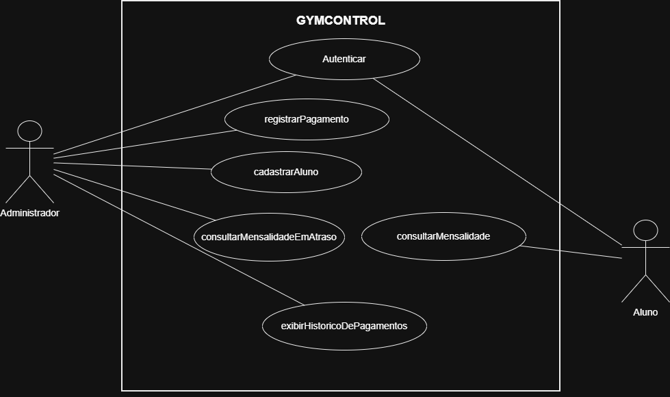

# 4.2.2 Modelagem de Casos de Us

## Atores

Dois papéis utilizam o GYMCONTROL: o Administrador e o Aluno. O ator representa o papel, não a pessoa. O Administrador é responsável pelo gerenciamento dos alunos e dos pagamentos, enquanto o Aluno utiliza o sistema para consultar suas mensalidades.

Quem opera o sistema é o ator, mesmo quando outra pessoa se beneficia. O Administrador registra os pagamentos e acompanha a situação financeira dos alunos. O Aluno consulta suas próprias mensalidades para acompanhar seus pagamentos.

| Ator | Quem é | O que faz no sistema |
|---|---|---|
| Aluno | pessoa cadastrada na academia | consulta suas mensalidades e acompanha a situação dos pagamentos |
| Administrador | responsável pelo gerenciamento do sistema na academia | cadastra alunos, registra pagamentos, consulta mensalidades em atraso e consulta o histórico de pagamentos |

## Casos de uso

Cada caso de uso é um objetivo que um ator alcança no sistema. O nome é o mesmo do requisito que ele atende, letra por letra.

Nem todo requisito vira elipse. O RF07 (Controlar permissões) é uma atividade interna do sistema, realizada durante o acesso às funcionalidades protegidas, e não um objetivo independente que o usuário vem realizar. Ele aparece como parte do controle de acesso às funcionalidades.

| Caso de uso | Ator | Atende |
|---|---|---|
| Cadastrar aluno | Administrador | RF01 |
| Registrar pagamento | Administrador | RF02 |
| Consultar mensalidade em atraso | Administrador | RF03 |
| Consultar mensalidade | Aluno | RF04 |
| Exibir histórico de pagamentos | Administrador | RF05 |
| Autenticar | Administrador e Aluno | RF06 |

## Diagrama de casos de uso

**Figura 1 – Diagrama de casos de uso do GYMCONTROL**

Fonte: Autoria própria (2026).

A Figura 1 mostra a fronteira com o nome do sistema e os dois atores do lado de fora. O Aluno se liga aos casos de uso Autenticar e Consultar mensalidade. O Administrador se liga aos casos de uso Autenticar, Cadastrar aluno, Registrar pagamento, Consultar mensalidade em atraso e Exibir histórico de pagamentos.

Não há relacionamentos «include» ou «extend» no diagrama. O controle de permissões é realizado internamente pelo sistema durante o acesso às funcionalidades protegidas, não sendo representado como um caso de uso independente.

## Especificação do caso de uso principal

Registrar pagamento é o caso de uso que o sistema existe para facilitar: ele permite controlar os pagamentos das mensalidades e manter atualizada a situação financeira dos alunos. Por isso, é o caso especificado.

| Campo |  |
|---|---|
| Caso de uso | Registrar pagamento |
| Ator | Administrador |
| Pré-condição | O administrador está autenticado no sistema, possui permissão para registrar pagamentos e o aluno está cadastrado. |
| Pós-condição | O pagamento está registrado e consta no histórico de pagamentos do aluno. |

**Fluxo principal**

1. O administrador identifica o aluno.
2. O sistema apresenta os dados cadastrais do aluno.
3. O administrador informa os dados do pagamento.
4. O sistema verifica as informações fornecidas.
5. O administrador confirma o registro do
