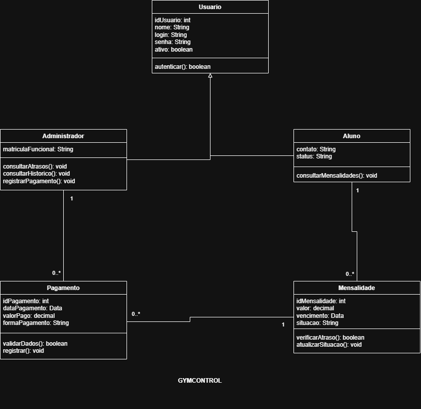

# 4.2.3 Modelagem de Classes

<!--
Esta seção responde: o que o sistema precisa lembrar para que os casos de uso aconteçam, e como essas coisas se ligam?

São cinco blocos, na ordem em que aparecem. Cada tabela já tem a primeira linha começada.
Troque o que está em itálico pelo seu texto e acrescente linhas até o teto: 4 a 6 classes.

As classes saem dos substantivos do fluxo que você especificou na 4.2.2 e dos RF da 4.2.1.
O diagrama vai em dois arquivos com o mesmo nome: diagramas/classes.drawio (para editar) e diagramas/classes.png (para aparecer aqui).
A numeração das figuras continua a da 4.2.2: se lá você chegou à Figura 1, aqui é a Figura 2.

A mesma seção pronta, do BiblioTech, está em exemplo-bibliotech/docs/4.2.3-classes.md
no repositório do modelo, com os diagramas em exemplo-bibliotech/diagramas/. O BiblioTech mostra a forma. As classes têm de ser suas.

Quando terminar, pode apagar estes comentários.
-->

## Dos substantivos às classes

<!-- Leia o fluxo principal da sua especificação e a sua lista de RF. Marque os substantivos.
     Três filtros: detalhe de outra coisa vira atributo. Tela, botão e relatório não entram. O que está fora do sistema não entra. -->

| Substantivo | De onde veio | Vira | Por quê |
|---|---|---|---|
| _substantivo_ | _passo N do fluxo, ou RFNN_ | _classe Nome, atributo de Nome, ou nada_ | _em uma frase_ |

## Classes

<!-- 4 a 6 classes. Nome no singular com inicial maiúscula. Atributos como nome: tipo (substantivo). Operações com parênteses (verbo).
     A coluna "Veio de" diz o passo do fluxo ou o requisito que pede aquele atributo ou aquela operação. Sem origem, não entra. -->

| Classe | Atributos | Operações | Veio de |
|---|---|---|---|
| **_Nome_** | _- atributo: tipo_ | _+ operacao(): tipo_ | _passo N, RFNN_ |

## Diagrama de classes

<!-- Desenhe no draw.io. Caixa de três faixas por classe. Associação: linha contínua, verbo no meio, número nas duas pontas, colado na classe que ele conta.
     Herança: triângulo vazado na classe geral, sem número, só onde "é um tipo de" é verdadeiro.
     Parte e todo: losango do lado do todo, só onde "é parte de" é verdadeiro. Apagou o todo e a parte morreu junto: losango cheio (composição). A parte sobreviveu: losango vazado (agregação).
     Salve diagramas/classes.drawio e exporte diagramas/classes.png. Legenda acima, fonte abaixo, e a figura descrita no texto. -->

**Figura _N_ – Diagrama de classes do _Nome do Sistema_**

Fonte: Autoria própria (2026).

_Descreva a figura. As associações com os números lidos como frase, a herança ou por que não há, a parte e todo ou por que não há, e o teste que decidiu._

## Teste de objetos

<!-- Pegue uma situação real do seu cliente: um pedido, um atendimento, uma reserva. Liste os objetos dela, 3 ou 4 caixas no formato nome: Classe, com os valores.
     Depois leia cada linha do seu diagrama olhando para os objetos: o número que você escreveu aguenta a situação real? -->

_Conte a situação em uma ou duas frases._

| Objeto | Classe | Valores |
|---|---|---|
| `_nome_` | _Classe_ | _atributo = valor, atributo = valor_ |

**Ligações:** _`objeto` e `objeto`, ..._

**O que o teste confirma**

- _**Frase lida do diagrama.** O que os objetos mostram sobre ela: confirmou, ou derrubou e o que mudou._

## Rastreabilidade com a 4.2.2

<!-- Toda operação e os atributos principais, um por linha, com o passo do fluxo ou o requisito que a pede.
     Depois responda as três perguntas. -->

| Operação ou atributo | Classe | De onde veio |
|---|---|---|
| _operacao()_ | _Classe_ | _passo N de Nome do caso de uso, ou RFNN_ |

_Toda operação tem origem? Todo passo do sistema tem casa? O que a modelagem mudou?_
