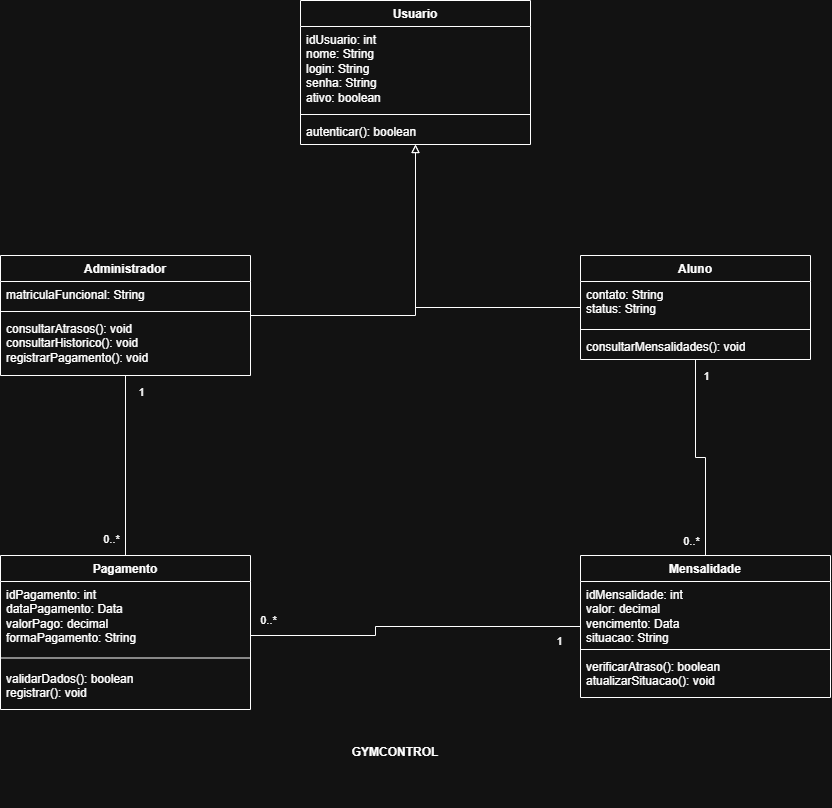

# 4.2.3 Modelagem de Classes

## Dos substantivos às classes

| Substantivo | De onde veio | Vira | Por quê |
|---|---|---|---|
| Usuário | RF06 – Autenticar | Classe Usuario | Representa quem acessa o sistema. |
| Administrador | RF01, RF02, RF03 e RF05 | Classe Administrador | Representa o responsável pelas operações administrativas. |
| Aluno | RF01 e RF04 | Classe Aluno | Representa os alunos cadastrados no sistema. |
| Pagamento | RF02 e passo 6 do fluxo principal | Classe Pagamento | Representa os pagamentos registrados. |
| Mensalidade | RF03 e RF04 | Classe Mensalidade | Representa as mensalidades dos alunos. |
| Histórico de pagamentos | RF05 | Operação da classe Administrador | Representa a consulta aos pagamentos realizados. |
| Atraso | RF03 | Operação da classe Mensalidade | Permite verificar se uma mensalidade está atrasada. |
| Permissão | RF07 | Classe Usuario | Está relacionada ao controle de acesso dos usuários. |

## Classes

| Classe | Atributos | Operações | Veio de |
|---|---|---|---|
| **Usuario** | - idUsuario: int - nome: String - login: String - senha: String - ativo: boolean | + autenticar(): boolean | RF06 – Autenticar; RF07 – Controlar permissões |
| **Administrador** | - matriculaFuncional: String | + consultarAtrasos(): void + consultarHistorico(): void + registrarPagamento(): void | RF02, RF03 e RF05 |
| **Aluno** | - contato: String - status: String | + consultarMensalidades(): void | RF01 e RF04 |
| **Pagamento** | - idPagamento: int - dataPagamento: Data - valorPago: decimal - formaPagamento: String | + validarDados(): boolean + registrar(): void | RF02; passos 3, 4 e 6 do fluxo principal |
| **Mensalidade** | - idMensalidade: int - valor: decimal - vencimento: Data - situacao: String | + verificarAtraso(): boolean + atualizarSituacao(): void | RF03 e RF04; passo 7 do fluxo principal |

Os atributos apresentados são propostas de modelagem para representar as informações necessárias aos requisitos do sistema.

## Diagrama de classes

**Figura 2 – Diagrama de classes do GYMCONTROL**

Fonte: Autoria própria (2026).

A figura apresenta cinco classes: Usuario, Administrador, Aluno, Pagamento e Mensalidade.

As classes Administrador e Aluno possuem herança da classe Usuario, pois representam tipos de usuários que acessam o sistema.

Na associação entre Administrador e Pagamento, um administrador pode realizar vários pagamentos, enquanto cada pagamento está relacionado a um administrador. Na associação entre Aluno e Mensalidade, um aluno pode possuir várias mensalidades, e cada mensalidade pertence a um aluno. Na associação entre Pagamento e Mensalidade, uma mensalidade pode estar relacionada a vários pagamentos, enquanto cada pagamento pertence a uma mensalidade.

O diagrama não utiliza composição ou agregação, pois não foi definida uma relação de parte e todo com dependência de existência entre as classes. A decisão foi manter as associações simples, já que o sistema permite representar os registros relacionados sem indicar que a exclusão de uma classe obrigatoriamente elimina a outra.

## Teste de objetos

A situação escolhida é o registro do pagamento de uma mensalidade de um aluno pelo administrador. O teste representa um aluno cadastrado, uma mensalidade e um pagamento registrado.

| Objeto | Classe | Valores |
|---|---|---|
| `administrador1` | Administrador | matriculaFuncional = "ADM001" |
| `aluno1` | Aluno | contato = "99999-9999", status = "Ativo" |
| `mensalidade1` | Mensalidade | idMensalidade = 1, valor = 120.00, vencimento = 10/11/2026, situacao = "Paga" |
| `pagamento1` | Pagamento | idPagamento = 1, dataPagamento = 09/11/2026, valorPago = 120.00, formaPagamento = "Pix" |

**Ligações:** `administrador1` e `pagamento1`; `aluno1` e `mensalidade1`; `mensalidade1` e `pagamento1`.

**O que o teste confirma**

- **Um aluno pode possuir várias mensalidades.** O objeto demonstra que uma mensalidade está vinculada ao aluno.
- **Um administrador pode registrar vários pagamentos.** O objeto demonstra um pagamento relacionado ao administrador.
- **Uma mensalidade pode possuir vários pagamentos.** O objeto demonstra um pagamento relacionado à mensalidade.

## Rastreabilidade com a 4.2.2

| Operação ou atributo | Classe | De onde veio |
|---|---|---|
| idUsuario, nome, login, senha e ativo | Usuario | RF06 – Autenticar; RF07 – Controlar permissões |
| autenticar() | Usuario | RF06 – Autenticar |
| matriculaFuncional | Administrador | RF01 – Cadastrar aluno e operações administrativas |
| consultarAtrasos() | Administrador | RF03 – Consultar mensalidade em atraso |
| consultarHistorico() | Administrador | RF05 – Exibir histórico de pagamentos |
| registrarPagamento() | Administrador | RF02 – Registrar pagamento |
| contato e status | Aluno | RF01 – Cadastrar aluno |
| consultarMensalidades() | Aluno | RF04 – Consultar mensalidade |
| idPagamento, dataPagamento, valorPago e formaPagamento | Pagamento | RF02 – Registrar pagamento; passo 3 do fluxo principal |
| validarDados() | Pagamento | Passo 4 do fluxo principal |
| registrar() | Pagamento | Passo 6 do fluxo principal |
| idMensalidade, valor, vencimento e situacao | Mensalidade | RF03 – Consultar mensalidade em atraso; RF04 – Consultar mensalidade |
| verificarAtraso() | Mensalidade | RF03 – Consultar mensalidade em atraso |
| atualizarSituacao() | Mensalidade | Passo 7 do fluxo principal |

**Toda operação tem origem?**

Sim. As operações foram relacionadas aos requisitos funcionais ou às etapas do fluxo principal da seção 4.2.2.

**Todo passo do sistema tem casa?**

Sim. As etapas relacionadas ao cadastro, à consulta de mensalidades e ao registro de pagamentos são representadas pelas classes do modelo.

**O que a modelagem mudou?**

A modelagem organizou os dados e as operações do sistema em cinco classes, definindo seus atributos, operações e relacionamentos para representar o funcionamento do GYMCONTROL.
