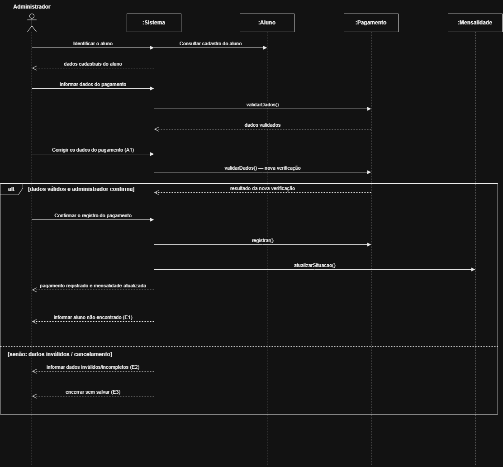

# 4.2.4 Modelagem de Sequência

## Do fluxo às mensagens

| No fluxo da 4.2.2 | Vira a mensagem | De quem para quem | Por quê |
|---|---|---|---|
| Passo 1 – O administrador identifica o aluno. | Identificar o aluno | Administrador → Sistema | O ator solicita a identificação do aluno. |
| Passo 2 – O sistema apresenta os dados cadastrais. | Dados cadastrais apresentados | Sistema → Administrador | O sistema retorna os dados encontrados. |
| Passo 3 – O administrador informa os dados do pagamento. | Informar dados do pagamento | Administrador → Sistema | O ator fornece as informações necessárias para o registro. |
| Passo 4 – O sistema verifica as informações. | `validarDados()` | Sistema → Pagamento | A operação pertence à classe Pagamento. |
| Passo 5 – O administrador confirma o registro. | Confirmar o registro | Administrador → Sistema | O ator autoriza a continuidade do registro. |
| Passo 6 – O sistema registra o pagamento. | `registrar()` | Sistema → Pagamento | A operação pertence à classe Pagamento. |
| Passo 7 – O sistema atualiza a situação da mensalidade. | `atualizarSituacao()` | Sistema → Mensalidade | A operação pertence à classe Mensalidade. |
| Passo 8 – O sistema disponibiliza o pagamento no histórico. | Pagamento registrado e histórico atualizado | Sistema → Administrador | O sistema informa a conclusão do registro e a atualização das informações. |

O fluxo alternativo A1, que trata da correção dos dados e da repetição da validação, não foi representado separadamente para manter o limite de mensagens. As exceções E1 e E3 também ficaram fora do diagrama, pois foi selecionada a exceção E2 para representar o desvio no fragmento `alt`.

## Diagrama de sequência

**Figura 5 – Diagrama de sequência de Registrar pagamento**

Fonte: Autoria própria (2026).

A figura apresenta quatro linhas de vida: o Administrador, que inicia as solicitações; o Sistema, que coordena o registro; a classe Pagamento, responsável pela validação e pelo registro; e a classe Mensalidade, responsável pela atualização da situação da mensalidade.

A sequência começa com o Administrador identificando o aluno e recebendo os dados cadastrais apresentados pelo Sistema. Em seguida, informa os dados do pagamento. O Sistema solicita à classe Pagamento a validação das informações por meio da operação `validarDados()`, recebendo o resultado da verificação.

No fragmento `alt`, o primeiro caminho representa os dados válidos: o Administrador confirma o registro, o Sistema solicita a operação `registrar()` à classe Pagamento e, depois, solicita `atualizarSituacao()` à classe Mensalidade. Ao final, o Sistema informa que o pagamento foi registrado e que a mensalidade foi atualizada.

O segundo caminho representa os dados inválidos. Nesse caso, o Sistema informa o problema ao Administrador, conforme a exceção E2, encerrando o registro sem salvar o pagamento.

## Rastreabilidade com a 4.2.3

| Mensagem | Chega em | Operação na 4.2.3 | Passo da 4.2.2 |
|---|---|---|---|
| `validarDados()` | Pagamento | `validarDados(): boolean` | Passo 4 |
| `registrar()` | Pagamento | `registrar(): void` | Passo 6 |
| `atualizarSituacao()` | Mensalidade | `atualizarSituacao(): void` | Passo 7 |

**Toda mensagem com parênteses chega em quem tem a operação?**

Sim. As três mensagens com operações chegam às classes que as possuem: `validarDados()` e `registrar()` chegam em Pagamento, enquanto `atualizarSituacao()` chega em Mensalidade.

**Todo passo tem mensagem?**

Sim. Os oito passos do fluxo principal estão representados no diagrama, incluindo as solicitações do Administrador, as respostas do Sistema e as operações executadas pelas classes.

**O que o desenho mudou nas suas classes?**

O diagrama não exigiu a criação de novas operações nas classes. As operações utilizadas já estavam definidas na 4.2.3. A identificação do aluno e a apresentação dos dados cadastrais aparecem como ações do Sistema, pois não existe uma operação específica para essa consulta no modelo de classes.
