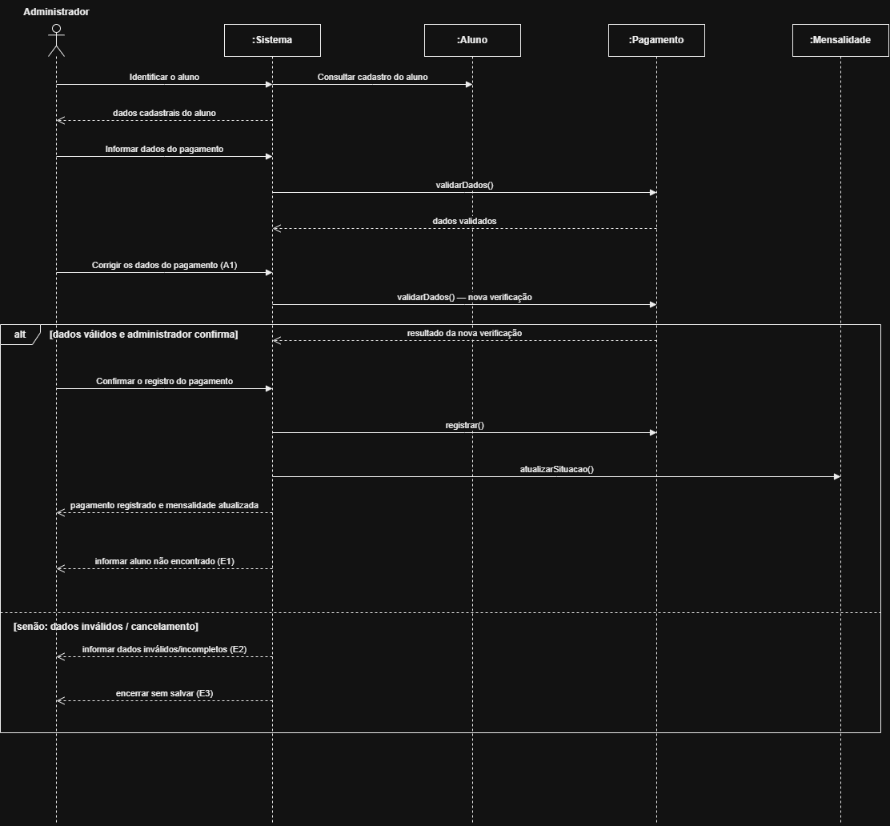

# 4.2.5 Modelagem de Atividade

## Do fluxo ao diagrama

| No fluxo da 4.2.2 | Vira | Raia | Por quê |
|---|---|---|---|
| 1. O administrador identifica o aluno. | Identificar o aluno | Administrador | O administrador inicia o processo de registro do pagamento. |
| 2. O sistema apresenta os dados cadastrais do aluno. | Apresentar os dados cadastrais | Sistema | O sistema apresenta as informações do aluno. |
| 3. O administrador informa os dados do pagamento. | Informar os dados do pagamento | Administrador | O administrador fornece as informações necessárias para o registro. |
| 4. O sistema verifica as informações fornecidas. | Verificar as informações e decidir se estão corretas | Sistema | O sistema confere os dados antes de permitir o registro. |
| 5. O administrador confirma o registro do pagamento. | Confirmar o registro do pagamento | Administrador | O administrador autoriza a conclusão do registro. |
| 6. O sistema registra o pagamento. | Registrar o pagamento | Sistema | O sistema salva as informações do pagamento. |
| 7. O sistema atualiza a situação da mensalidade. | Atualizar a situação da mensalidade | Sistema | O sistema atualiza a situação da mensalidade após o registro. |
| 8. O sistema disponibiliza o pagamento no histórico do aluno. | Disponibilizar o pagamento no histórico | Sistema | O sistema atualiza o histórico de pagamentos do aluno. |

## Diagrama de atividades

**Figura 3 – Diagrama de atividades do caso de uso Registrar pagamento**

Fonte: Autoria própria (2026).

O diagrama apresenta duas raias: Administrador e Sistema. O fluxo começa com o administrador identificando o aluno e informando os dados do pagamento. Em seguida, o sistema apresenta os dados cadastrais e verifica as informações fornecidas.

Após a verificação, o fluxo segue para a confirmação do administrador. Com a confirmação, o sistema registra o pagamento, atualiza a situação da mensalidade e disponibiliza o pagamento no histórico do aluno, finalizando o processo.

A decisão representa a verificação das informações do pagamento. A saída [sim] permite continuar o registro, enquanto a saída [não] deve seguir o fluxo alternativo previsto na especificação da seção 4.2.2.

O diagrama deve apresentar um fim para o fluxo principal e fins próprios para as exceções especificadas. O fluxo alternativo deve retornar ao processo por meio de uma junção.

## Rastreabilidade com a 4.2.2

| Elemento do diagrama | Vem de | Confere |
|---|---|---|
| Identificar o aluno | Fluxo principal – passo 1 | Sim |
| Apresentar os dados cadastrais | Fluxo principal – passo 2 | Sim |
| Informar os dados do pagamento | Fluxo principal – passo 3 | Sim |
| Verificar as informações | Fluxo principal – passo 4 | Sim |
| Decisão sobre a validade das informações | Fluxo principal – passo 4 | Sim |
| Confirmar o registro do pagamento | Fluxo principal – passo 5 | Sim |
| Registrar o pagamento | Fluxo principal – passo 6 | Sim |
| Atualizar a situação da mensalidade | Fluxo principal – passo 7 | Sim |
| Disponibilizar o pagamento no histórico | Fluxo principal – passo 8 | Sim |

Todo passo do fluxo principal possui um elemento correspondente no diagrama. A verificação das informações também foi representada por uma decisão, com duas saídas possíveis.

O desenho mantém a sequência do fluxo principal da especificação. A decisão transforma a verificação das informações em uma escolha visual entre continuar o registro ou seguir o fluxo alternativo.

**Nota:** Os fluxos alternativos e de exceção ainda precisam ser conferidos com a especificação original da seção 4.2.2 para garantir que todos estejam representados corretamente.
